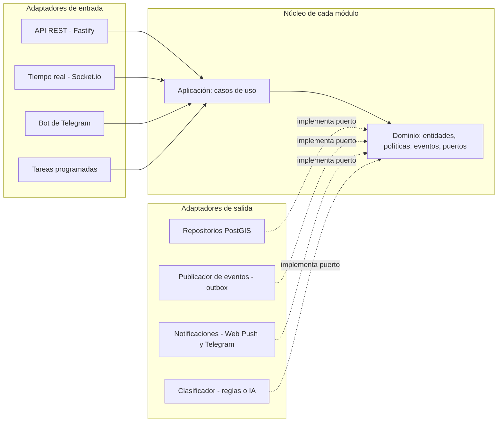

# Roadmap técnico: Plataforma GIS de alerta temprana

Oct 8, 2026 · @Darkii

Catorce fases en orden estricto de dependencia: una fase empieza solo cuando la anterior cumple el 100 % de su criterio de salida. Sin estimaciones de tiempo.

## Arquitectura

La plataforma será un **monolito modular con arquitectura hexagonal (puertos y adaptadores)**. No microservicios: con un solo equipo y hosting gratuito, los microservicios multiplican despliegues, red y fallos sin aportar escalabilidad que el piloto necesite. La arquitectura hexagonal da la mantenibilidad de los microservicios: el dominio no depende de nada, y la API, el WebSocket, el bot de Telegram y la IA son adaptadores intercambiables sobre el mismo núcleo.

**Regla de dependencia dentro de cada módulo (se verifica en CI):** `adapters → application → domain`. El dominio no importa nada externo; la capa de aplicación solo conoce el dominio y los puertos (interfaces).

La API, el WebSocket, el bot y las tareas son puertas de entrada al mismo núcleo; la base de datos, las notificaciones y la IA se conectan como implementaciones de sus puertos.

### Módulos por funcionalidad

El núcleo no se divide por capas sino por **módulos de funcionalidad**, cada uno con su propio hexágono (dominio, aplicación y adaptadores). Agregar o eliminar una función es agregar o borrar una carpeta y una línea de registro.

| Módulo | Responsabilidad | Prioridad |
| --- | --- | --- |
| `reports` | Crear, listar, deduplicar y caducar reportes | Imprescindible |
| `verification` | Votos, "¿Sigue ahí?", reputación | Imprescindible |
| `identity` | Usuarios anónimos, JWT, roles | Imprescindible |
| `subscriptions` | Zonas suscritas | Importante |
| `notifications` | Web Push y Telegram | Importante |
| `heatmap` | Agregación espacial por celdas | Importante |
| `moderation` | Rechazo de reportes y auditoría | Deseable |
| `open-data` | Vista anonimizada y exportación | Deseable |
| `classifier` | Clasificación por reglas o IA | Deseable |

**Reglas de aislamiento (verificadas por dependency-cruiser en cada PR):**

1. Un módulo no importa código de otro módulo. Solo puede importar `packages/shared-kernel` (tipos mínimos comunes: `GeoPoint`, IDs, `DomainEvent`) y `packages/contracts`.
2. Los módulos se comunican por **eventos de integración** (`ReportCreated`, `ReportConfirmed`…) a través de un bus de eventos. Quien emite no sabe quién escucha.
3. Cada módulo es dueño de sus tablas y de sus migraciones. Ningún módulo consulta las tablas de otro; si necesita un dato, lo recibe en un evento o lo pide por un puerto propio que la raíz de composición conecta a la interfaz pública del módulo dueño (ADR-001).
4. Cada módulo expone un único punto de entrada `index.ts` con su función `register(app, bus, config)`. Solo la raíz de composición lo llama.
5. Cada módulo opcional tiene un interruptor de funcionalidad (`FEATURE_HEATMAP=false`). Apagado, no registra rutas, eventos ni tareas.

| Decisión | Elección | Motivo |
| --- | --- | --- |
| Estilo | Monolito modular hexagonal | Mantenibilidad sin coste operativo de microservicios |
| Repositorio | Monorepo pnpm workspaces | Un solo pipeline, tipos compartidos entre API, web y bot |
| Lenguaje | TypeScript estricto en todo el stack | Un solo lenguaje; errores detectados en compilación |
| Backend | Node.js + Fastify | Validación por esquema y alto rendimiento |
| Tiempo real | Socket.io | Reconexión y recuperación de estado incluidas |
| Base de datos | PostgreSQL + PostGIS | Consultas espaciales e índices GiST |
| Acceso a datos | Drizzle ORM + SQL espacial manual | Migraciones versionadas; PostGIS sin abstracciones ocultas |
| Validación y contratos | Zod (genera OpenAPI) | Un solo esquema para API, web y bot |
| Frontend | React + Vite + vite-plugin-pwa | PWA estática con modo sin conexión más simple que Next.js |
| Mapas | Leaflet + OpenStreetMap + leaflet.heat | Gratuito, liviano |
| Bot | Telegraf (API de bots de Telegram) | Gratuito, adaptador del mismo núcleo |
| IA (opcional) | Servicio Python FastAPI tras un puerto `ClassifierPort` | Se reemplaza por reglas sin tocar el núcleo |

Nota: el documento del proyecto mencionaba Next.js; se cambia a Vite porque la PWA se sirve como sitio estático y su modo sin conexión es más directo. Actualizar la matriz de marco lógico.

## Marco normativo ISO

**ISO/IEC/IEEE 12207** define *qué procesos* se ejecutan en cada fase; **ISO/IEC 25010** define *qué calidad* debe tener el producto y cómo se mide. Las metas de calidad se fijan en la Fase 0 y se convierten en compuertas automáticas de CI desde la Fase 1.

### Procesos ISO/IEC 12207 por fase

| Fase | Procesos técnicos | Procesos de gestión transversales |
| --- | --- | --- |
| 0 | Definición de necesidades de interesados; definición de requisitos | Planificación del proyecto; gestión de riesgos; aseguramiento de calidad |
| 1 | Definición de arquitectura | Gestión de la configuración; gestión de la información |
| 2–5 | Definición del diseño; implementación; verificación | Medición; aseguramiento de calidad |
| 6–10 | Implementación; integración; verificación | Gestión de la configuración; medición |
| 11 | Verificación; análisis del sistema | Aseguramiento de calidad; gestión de riesgos |
| 12 | Transición; operación | Gestión de la configuración |
| 13 | Validación; operación; mantenimiento | Evaluación y control del proyecto; medición |

### Metas de calidad ISO/IEC 25010

Prioridad: mantenibilidad, fiabilidad y eficiencia de desempeño. Seguridad como requisito mínimo.

| Característica | Subcaracterística | Métrica | Umbral | Herramienta (gratuita) |
| --- | --- | --- | --- | --- |
| Mantenibilidad | Modularidad | Violaciones de la regla de dependencia | 0 | dependency-cruiser |
| Mantenibilidad | Analizabilidad | Complejidad ciclomática por función | ≤ 10 | ESLint `complexity` |
| Mantenibilidad | Modificabilidad | Código duplicado | < 3 % | jscpd / SonarCloud |
| Mantenibilidad | Capacidad de prueba | Cobertura: dominio / aplicación / global | 95 % / 85 % / 75 % | Vitest + c8 |
| Fiabilidad | Disponibilidad | Tiempo en línea durante el piloto | ≥ 95 % | UptimeRobot |
| Fiabilidad | Tolerancia a fallos | Reportes perdidos tras corte de red | 0 | Pruebas Playwright sin conexión |
| Fiabilidad | Recuperabilidad | Restauración de respaldo probada | 1 restauración exitosa por versión | pg\_dump + GitHub Actions |
| Fiabilidad | Ausencia de fallos | Tasa de errores 5xx | < 1 % de solicitudes | Logs pino |
| Eficiencia | Comportamiento temporal | p95 de la API | < 300 ms | k6 |
| Eficiencia | Comportamiento temporal | Latencia de difusión de un reporte | < 2 s (p95) | k6 / Artillery con Socket.io |
| Eficiencia | Comportamiento temporal | Consulta espacial con 100.000 reportes | < 100 ms (p95) | EXPLAIN ANALYZE |
| Eficiencia | Utilización de recursos | JavaScript inicial de la PWA | < 250 KB comprimido | Lighthouse CI |
| Seguridad | Confidencialidad / integridad | Vulnerabilidades altas o críticas | 0 | npm audit, Dependabot, OWASP ZAP |

## Fase 0: Gobernanza y requisitos

Resultado: requisitos cerrados y trazables, y metas de calidad aprobadas. Sin esto no se escribe código.

**Documentación**

1. Crear la carpeta `docs/` con: `srs.md` (especificación de requisitos con la estructura de ISO/IEC/IEEE 29148), `glosario.md`, `riesgos.md`, `calidad.md` y `adr/`.
2. Redactar el glosario del dominio (lenguaje ubicuo): Reporte, Categoría, Confirmación, Negación, Caducidad, Reputación, Zona suscrita, Celda geográfica.
3. Escribir las historias de usuario **Imprescindibles** con ID (`HU-01`…) y criterios de aceptación en formato Dado/Cuando/Entonces:
   1. Crear un reporte en dos toques con ubicación automática.
   2. Ver reportes activos en el mapa en tiempo real.
   3. Confirmar o negar un reporte ("¿Sigue ahí?").
   4. Caducidad automática por categoría.
   5. Reportar sin conexión y enviar al reconectar.
4. Escribir las historias **Importantes** (mapa de calor, zonas suscritas, bot de Telegram) y **Deseables** (IA, datos abiertos, moderación) en el mismo formato.
5. Definir la tabla de categorías del MVP con su tiempo de vida (TTL), radio de deduplicación y si es sensible (ubicación redondeada).
6. Definir las reglas de verificación: número de confirmaciones para `CONFIRMADO`, número de negaciones para `RESUELTO`, peso del voto según reputación.
7. Copiar las metas de la tabla ISO/IEC 25010 en `calidad.md` como requisitos no funcionales con ID (`RNF-01`…).
8. Registrar riesgos con mitigación: servidor gratuito que se duerme, mapa vacío, baja adopción de Telegram, reportes falsos, límites de los planes gratuitos.
9. Escribir `ADR-001` (monolito modular hexagonal) y `ADR-002` (stack) con contexto, decisión y consecuencias.
10. Crear la matriz de trazabilidad `trazabilidad.md`: requisito → historia → caso de prueba (se completa en cada fase).
11. Definir la Definición de Hecho (DoD): código revisado, pruebas en verde, compuertas de calidad superadas, documentación y trazabilidad actualizadas.

**Criterio de salida**

- [x] SRS con todas las historias Imprescindibles y sus criterios de aceptación
- [x] Tabla de categorías con TTL y reglas de verificación con valores numéricos
- [x] RNF ISO/IEC 25010 con umbrales
- [x] ADR-001 y ADR-002 aprobados
- [x] Registro de riesgos y DoD publicados

## Fase 1: Base arquitectónica y cadena de calidad

Resultado: un esqueleto que compila, se prueba y se despliega, con la arquitectura hexagonal impuesta por la CI.

**Configuración**

1. Crear el repositorio público en GitHub con rama protegida `main` (requiere PR y CI en verde). Flujo trunk-based con ramas cortas.
2. Inicializar el monorepo con pnpm workspaces:
   1. `apps/api`: raíz de composición del servidor (Fastify + Socket.io). Solo registra módulos; no contiene lógica.
   2. `apps/web`: PWA React + Vite.
   3. `apps/bot`: bot de Telegram.
   4. `packages/shared-kernel`: lo mínimo común a todos los módulos: `GeoPoint`, IDs tipados, `DomainEvent`, `Result`, errores base, puerto `Clock`. Sin dependencias.
   5. `packages/event-bus`: puerto `EventBus` y su implementación en memoria (la versión con outbox llega en la Fase 7).
   6. `packages/contracts`: esquemas Zod de la API y de los eventos de integración, versionados.
   7. `packages/platform`: infraestructura compartida sin reglas de negocio: pool de PostgreSQL, logger, carga de configuración, interruptores de funcionalidad.
   8. `packages/modules/<nombre>`: un paquete por módulo de la tabla de Arquitectura, cada uno con `domain/`, `application/`, `adapters/`, `migrations/`, `tests/` e `index.ts`.
3. Crear con un generador (plop) la plantilla de módulo, para que cada módulo nuevo nazca con la misma estructura, pruebas vacías y registro listo.
4. Configurar TypeScript estricto (`strict`, `noUncheckedIndexedAccess`) con `tsconfig` base compartido y referencias de proyecto.
5. Configurar ESLint (incluida la regla `complexity: 10`), Prettier, Husky + lint-staged y Commitlint (Conventional Commits).
6. Configurar dependency-cruiser con estas reglas:
   1. Dentro de un módulo: `adapters → application → domain`; `domain` solo importa `shared-kernel`.
   2. Un módulo no importa nada de otro módulo, tampoco su `index.ts`.
   3. Solo `apps/*` importa los `index.ts` de los módulos.
   4. Ningún paquete importa desde `apps/*`.
7. Implementar los interruptores de funcionalidad en `packages/platform`: variables `FEATURE_<MODULO>` validadas con Zod y una función `isEnabled(modulo)` que usa la raíz de composición.
8. Crear `docker-compose.yml` con `postgis/postgis` para desarrollo local, y `.env.example` con todas las variables.
9. Configurar Vitest con cobertura c8 y umbrales por capa (dominio 95 %, aplicación 85 %) aplicados a cada módulo.
10. Crear el pipeline de GitHub Actions: instalar → lint → typecheck → dependency-cruiser → pruebas con cobertura → build. Cualquier fallo bloquea el merge.
11. Conectar SonarCloud (gratuito para repositorios públicos) con compuerta de calidad: duplicación < 3 %, 0 bugs y 0 vulnerabilidades nuevas.
12. Activar Dependabot y `npm audit` en la CI.
13. Configurar semantic-release para versiones y `CHANGELOG.md` automáticos.

**Codificación**

1. Endpoint `GET /health` que devuelve versión y estado de la conexión a la base de datos.
2. Logger pino estructurado con ID de correlación por solicitud.
3. Carga de configuración validada con Zod: la aplicación no arranca si falta una variable.
4. Servidor Socket.io mínimo que emite `ping` cada pocos segundos.
5. PWA mínima con un mapa Leaflet centrado en La Paz que muestra el `ping` recibido.

**Pruebas**

1. Prueba de arquitectura: dependency-cruiser falla si se introduce una importación prohibida. Verificar con dos PR de prueba que deben ser rechazados: uno que importa infraestructura desde un dominio y otro que importa un módulo desde otro módulo.
2. Prueba de integración de `/health` contra PostGIS levantado con Testcontainers.
3. **Despliegue de humo a staging:** API en Render (plan gratuito), web en Vercel, base de datos en Supabase o Neon con PostGIS. Confirmar que el WebSocket funciona a través del proxy de Render. Si no funciona, cambiar a Oracle Cloud Always Free ahora, no al final.
4. Prueba de módulos: generar con plop un módulo de ejemplo `sandbox` que expone una ruta y escucha un evento; con `FEATURE_SANDBOX=false` la ruta devuelve 404 y el evento no se procesa. Luego borrar la carpeta del módulo y su línea de registro: el sistema compila y todas las pruebas siguen en verde.

**Criterio de salida**

- [x] CI en verde con todas las compuertas activas
- [x] Un PR que viola la arquitectura es rechazado automáticamente
- [x] `/health` y el `ping` de WebSocket funcionan en staging
- [x] Un módulo se puede apagar por interruptor y eliminar sin romper la compilación ni las pruebas

## Fase 2: Modelo de dominio

Resultado: las reglas de negocio de cada módulo en TypeScript puro, dentro de su carpeta `domain/`, sin base de datos, HTTP ni frameworks. Primero el núcleo compartido, luego los módulos Imprescindibles; los demás se modelan cuando llegue su fase.

**Codificación**

1. `shared-kernel`: objetos de valor inmutables con validación en el constructor:
   1. `GeoPoint` (latitud y longitud dentro del rectángulo envolvente de La Paz y El Alto; fuera de él, error).
   2. IDs tipados: `ReportId`, `UserId`, `CategoryCode`.
   3. Clase base `DomainEvent` con `id`, `type`, `version`, `occurredAt`.
2. `contracts`: definir con Zod y versionar los **eventos de integración** entre módulos: `ReportCreated.v1`, `ReportConfirmed.v1`, `ReportResolved.v1`, `ReportExpired.v1`, `ReportRejected.v1`, `ReportDuplicateDetected.v1`, `VoteCast.v1`. Un cambio incompatible crea `v2`; nunca se modifica un evento publicado.
3. Módulo `identity`: entidad `User` (identificador anónimo de dispositivo, rol, Telegram ID opcional).
4. Módulo `reports`:
   1. Entidad `Category`: código, nombre, TTL, radio de deduplicación, indicador de sensible.
   2. Agregado raíz `Report` con máquina de estados explícita: `ACTIVO → CONFIRMADO`, `ACTIVO|CONFIRMADO → RESUELTO | CADUCADO | RECHAZADO`. Toda transición inválida lanza un error de dominio.
   3. Métodos: `markConfirmed()`, `markResolved()`, `expire(now)`, `reject(motivo)`, `extendExpiration()`.
   4. Políticas puras: `ExpirationPolicy` (caducidad desde el TTL) y `PrivacyPolicy` (redondeo de ubicación en categorías sensibles).
   5. Puertos: `ReportRepository`, `CategoryRepository`, `IdGenerator`.
5. Módulo `verification`:
   1. Entidad `Vote` (un voto por usuario y reporte; el autor no vota su propio reporte) y entidad `Reputation`.
   2. `VerificationPolicy`: decide, según votos ponderados por reputación, si un reporte debe confirmarse o resolverse.
   3. `ReputationPolicy`: sube la reputación del autor cuando su reporte se confirma y la baja cuando se rechaza.
   4. No modifica reportes directamente: emite `VoteCast` y una decisión; el módulo `reports` escucha y aplica la transición.
   5. Puertos: `VoteRepository`, `ReputationRepository`, y un puerto propio `ReportLookup` para saber el autor, el estado y la ubicación de un reporte; su adaptador lo conecta la raíz de composición a la interfaz pública de `reports`.
6. Para cada módulo, escribir su `README.md`: responsabilidad, eventos que emite, eventos que escucha, interfaz pública y tablas propias. Es el contrato del módulo.

**Pruebas**

1. Pruebas unitarias de cada transición válida e inválida de la máquina de estados.
2. Pruebas basadas en propiedades con fast-check para `GeoPoint`, `VerificationPolicy` y `ExpirationPolicy` (por ejemplo: la caducidad nunca es anterior a la creación).
3. Cada criterio de aceptación de la Fase 0 que sea una regla de negocio tiene al menos una prueba con su ID en el nombre (`HU-03: ...`).

**Criterio de salida**

- [ ] Cobertura del dominio ≥ 95 %
- [ ] 0 dependencias externas en los `dominios de los módulos y en shared-kernel` (verificado por dependency-cruiser)
- [ ] Todos los puertos y eventos de integración definidos, con el README de cada módulo e incluidos en la trazabilidad

## Fase 3: Modelado de datos y persistencia PostGIS

Resultado: el esquema físico versionado y los adaptadores de repositorio que implementan los puertos de la Fase 2.

**Diseño**

1. Derivar el modelo E-R del modelo de dominio (no al revés) y dibujarlo en PlantUML dentro de `docs/`.
2. Escribir el diccionario de datos: tabla, columna, tipo, restricción, descripción.

**Codificación (migraciones versionadas con Drizzle Kit)**

1. Migración 001: `CREATE EXTENSION postgis`.
2. Tabla `categories`: `code` PK, `name`, `ttl_minutes`, `dedup_radius_m`, `is_sensitive`.
3. Tabla `users`: `id` UUID, `device_hash`, `telegram_id` único y nulo, `role`, `created_at`. La reputación no vive aquí: es del módulo `verification`.
4. Tabla `reports`:
   1. `id` UUID, `category_code` FK, `author_id` FK, `status`, `description`, `created_at`, `expires_at`.
   2. `location geometry(Point, 4326)` (ubicación real, nunca expuesta).
   3. `public_location geometry(Point, 4326)` (ubicación mostrada; redondeada si la categoría es sensible).
   4. `idempotency_key` único (evita duplicados al reenviar reportes guardados sin conexión).
   5. `CHECK` sobre `status` con los valores de la máquina de estados.
5. Tabla `votes`: PK compuesta (`report_id`, `user_id`), `value` (confirma/niega), `weight`, `created_at`. Tabla `reputations` (también de `verification`): `user_id` PK, `score`, `last_penalty_at`, `updated_at`.
6. Tabla `zone_subscriptions`: `id`, `user_id`, `center geography(Point)`, `radius_m` con `CHECK` de máximo, `categories text[]`.
7. Tabla `outbox_events`: `id`, `type`, `payload jsonb`, `created_at`, `published_at` (patrón outbox para la Fase 7).
8. Tabla `moderation_actions`: auditoría de quién rechazó qué y por qué.
9. Índices: GiST en `reports.location` y `reports.public_location`; GiST en `zone_subscriptions.center`; B-tree parcial en `reports (status, expires_at) WHERE status IN ('ACTIVO','CONFIRMADO')`; B-tree en `outbox_events (published_at) WHERE published_at IS NULL`.
10. Semilla: las cinco categorías del MVP con sus TTL.
11. Adaptadores de repositorio dentro de `adapters/` de cada módulo (`reports`, `identity`, `verification`, `subscriptions`). Cada módulo guarda sus migraciones en su propia carpeta `migrations/` y solo toca sus tablas; no hay claves foráneas entre tablas de módulos distintos (se guarda el ID y se valida por evento o interfaz pública). Mapeo explícito fila ↔ entidad: el dominio nunca ve tipos de Drizzle.
12. Unidad de trabajo transaccional: guardar el agregado y sus eventos en `outbox_events` en la misma transacción.

**Pruebas**

1. Pruebas de integración de cada repositorio contra PostGIS real con Testcontainers.
2. Prueba de migración: aplicar todas las migraciones sobre una base vacía y luego revertir la última sin errores.
3. Prueba de restricciones: un voto duplicado, un estado inválido y una `idempotency_key` repetida son rechazados por la base de datos.
4. Prueba de atomicidad: si falla la escritura del evento, el reporte tampoco se guarda.
5. Prueba de independencia: con `FEATURE_SUBSCRIPTIONS=false`, sus migraciones no se ejecutan y el resto del sistema arranca y pasa todas sus pruebas.

**Criterio de salida**

- [ ] Diagrama E-R y diccionario de datos publicados
- [ ] Migraciones reproducibles desde cero en CI
- [ ] Todos los repositorios pasan las pruebas de integración

## Fase 4: Core geoespacial

Resultado: todas las consultas espaciales implementadas, indexadas y medidas con volumen realista.

**Codificación**

1. Añadir al puerto `ReportRepository` los métodos espaciales y luego implementarlos en el adaptador PostGIS:
   1. `findInViewport(bbox, categorias, estados)`: `public_location && ST_MakeEnvelope(...)` para usar el índice GiST.
   2. `findNearby(punto, radio_m)`: `ST_DWithin(location::geography, punto::geography, radio_m)`.
   3. `findDuplicate(categoria, punto, ventana)`: mismo tipo, dentro de `dedup_radius_m` y activo. Si existe, el nuevo reporte se convierte en confirmación del existente.
   4. `findExpired(now)`: reportes activos con `expires_at < now`, en lotes.
2. Puerto y adaptador `HeatmapQuery.aggregate(bbox, tamaño_celda, desde, hasta, categorias)`: agrupar con `ST_SnapToGrid` y devolver solo celdas con al menos 3 reportes (umbral de anonimato y antiestigmatización).
3. Puerto y adaptador `SubscriptionRepository.matchSubscribers(punto, categoria)`: suscripciones cuyo círculo contiene el punto (`ST_DWithin` contra `center` y `radius_m`).
4. Función pura en el dominio `cellOf(GeoPoint, precision)`: codificación geohash propia (sin librería) para agrupar clientes de WebSocket por celda en la Fase 7. Precisión por defecto: 6.
5. Función pura `cellsCovering(bbox)`: lista de celdas que cubren el área visible del mapa.
6. Implementar el redondeo de `PrivacyPolicy` con `ST_SnapToGrid` al guardar `public_location`.

**Pruebas**

1. Pruebas de integración con geometrías conocidas: puntos dentro, en el borde y fuera de cada consulta.
2. Prueba de `cellOf` contra vectores de referencia de geohash publicados.
3. Script `seed:load` que genera 100.000 reportes sintéticos distribuidos sobre La Paz y El Alto.
4. Ejecutar `EXPLAIN ANALYZE` de cada consulta con esa carga: debe usar el índice (Index Scan / Bitmap Index Scan) y cumplir p95 < 100 ms. Guardar los planes en `docs/rendimiento/`.
5. Prueba del heatmap: una celda con 2 reportes no aparece; con 3, sí.

**Criterio de salida**

- [ ] Todas las consultas espaciales usan índice y cumplen p95 < 100 ms con 100.000 reportes
- [ ] Deduplicación y umbral del heatmap probados
- [ ] Planes de ejecución archivados como evidencia de eficiencia (ISO/IEC 25010)

## Fase 5: Casos de uso

Resultado: la lógica completa de la aplicación en la carpeta `application/` de cada módulo, ejecutable sin HTTP ni WebSocket. Desde aquí, API, bot y web solo llaman a estos casos de uso a través del `index.ts` público de cada módulo. Las reacciones entre módulos (votar → confirmar reporte → notificar) se implementan como manejadores de eventos, nunca como llamadas directas.

**Codificación** (cada caso de uso: una clase con un método `execute(input)`, entrada validada con Zod, dependencias inyectadas por constructor como puertos)

1. `RegisterDevice`: crea o recupera un usuario anónimo a partir del hash del dispositivo.
2. `CreateReport`: valida la categoría y el `GeoPoint` → consulta `findDuplicate` → si hay duplicado, no crea el reporte y emite `ReportDuplicateDetected`, que `verification` registra como confirmación; si no, crea el agregado, aplica `PrivacyPolicy` y `ExpirationPolicy`, y guarda reporte y evento en una transacción. Idempotente por `idempotency_key`.
3. `ConfirmReport` y `DenyReport` ("¿Sigue ahí?"): registran el voto ponderado, aplican `VerificationPolicy` y `ReputationPolicy`, y emiten el evento correspondiente.
4. `ListReportsInViewport`: devuelve reportes activos y confirmados del área visible.
5. `GetHeatmap`: devuelve celdas agregadas para un rango de fechas.
6. `SubscribeZone` y `UnsubscribeZone`: con límite de zonas por usuario.
7. `ExpireReports`: procesa en lotes los reportes vencidos y emite `ReportExpired`.
8. `NotifySubscribers`: ante `ReportCreated` o `ReportConfirmed`, busca suscriptores con `matchSubscribers` y envía por `NotificationSender`.
9. `RejectReport` (moderador): cambia el estado, registra la acción y ajusta la reputación.
10. Puerto `RateLimiter` y su uso en `CreateReport` y en los votos (límite por usuario y por ventana de tiempo).
11. Errores de aplicación tipados (`NotFound`, `Forbidden`, `Conflict`, `ValidationFailed`, `RateLimited`) que los adaptadores traducen a su protocolo.

**Pruebas**

1. Pruebas de cada caso de uso con adaptadores falsos en memoria (repositorios, reloj controlable, publicador que registra eventos).
2. Escenarios de aceptación de la Fase 0 escritos como pruebas de casos de uso, con el ID de la historia en el nombre.
3. Prueba de idempotencia: enviar el mismo `CreateReport` dos veces produce un solo reporte.
4. Prueba de deduplicación: dos reportes del mismo tipo a 20 m generan un reporte con una confirmación.

**Criterio de salida**

- [ ] Cobertura de aplicación ≥ 85 %
- [ ] Todas las historias Imprescindibles pasan como pruebas de casos de uso
- [ ] Matriz de trazabilidad actualizada hasta el nivel de prueba

## Fase 6: API REST y seguridad

Resultado: el adaptador HTTP en `apps/api` expone los casos de uso con contrato OpenAPI y protecciones básicas.

**Codificación**

1. Raíz de composición (`apps/api/src/main.ts`): único lugar donde se instancian adaptadores y se inyectan en los casos de uso.
2. Rutas versionadas `/v1`, cada una delgada (valida, llama al caso de uso, traduce el resultado):
   1. `POST /v1/devices` → `RegisterDevice` (devuelve un JWT firmado del dispositivo).
   2. `POST /v1/reports` (cabecera `Idempotency-Key` obligatoria) → `CreateReport`.
   3. `GET /v1/reports?bbox=&categories=` → `ListReportsInViewport`.
   4. `POST /v1/reports/:id/confirm` y `/deny` → votos.
   5. `GET /v1/heatmap?bbox=&from=&to=` → `GetHeatmap`.
   6. `POST` y `DELETE /v1/subscriptions` → zonas suscritas.
   7. `POST /v1/moderation/reports/:id/reject` (rol `MODERADOR`).
3. Generar el documento OpenAPI desde los esquemas Zod de `packages/contracts` y publicarlo con Swagger UI en `/docs`.
4. Errores en formato RFC 7807 (`application/problem+json`) mapeados desde los errores de aplicación.
5. Seguridad: `@fastify/helmet`, CORS restringido al dominio de la PWA, `@fastify/rate-limit` como adaptador de `RateLimiter`, límite de tamaño de cuerpo, JWT con expiración y rotación.
6. Nunca devolver `location` real ni `author_id` en respuestas públicas: solo `public_location`. Prueba específica para esto.
7. Apagado ordenado: al recibir `SIGTERM`, dejar de aceptar conexiones y cerrar el pool de la base de datos.
8. Generar el cliente TypeScript tipado desde OpenAPI para que lo usen la web y el bot.

**Pruebas**

1. Pruebas de extremo a extremo de cada ruta con `fastify.inject` y PostGIS en Testcontainers.
2. Pruebas de contrato: la respuesta real valida contra el esquema OpenAPI.
3. Pruebas negativas: sin token, token vencido, rol insuficiente, entrada inválida, límite de solicitudes superado.
4. Prueba de privacidad: ninguna respuesta contiene campos `location` ni `author_id`.
5. Escaneo OWASP ZAP (modo baseline) contra staging en la CI.

**Criterio de salida**

- [ ] OpenAPI publicado y cliente generado
- [ ] 0 hallazgos altos en ZAP
- [ ] p95 < 300 ms en staging con carga básica de k6

## Fase 7: Tiempo real y fiabilidad de eventos

Resultado: cada cambio de un reporte llega a los clientes que miran esa zona en menos de 2 segundos, sin perder eventos si el proceso se reinicia.

**Codificación**

1. Despachador de outbox (`OutboxDispatcher`): lee `outbox_events` sin publicar con `SELECT ... FOR UPDATE SKIP LOCKED`, los publica y marca `published_at`. Es la implementación definitiva del puerto EventBus: entrega cada evento, al menos una vez, a Socket.io y a los manejadores de los demás módulos; cada evento lleva su `id` para que el cliente descarte duplicados.
2. Adaptador `SocketIoEventPublisher` que implementa `EventPublisher`: emite cada evento a la sala `cell:<geohash>` de la celda del reporte.
3. Protocolo del cliente: al mover el mapa, el cliente envía `viewport:update` con su bbox; el servidor calcula `cellsCovering(bbox)` y actualiza las salas del socket (con un máximo de celdas por cliente).
4. Autenticación del handshake de Socket.io con el mismo JWT de la API.
5. Activar `connectionStateRecovery` de Socket.io para recuperar eventos perdidos en desconexiones breves; tras una desconexión larga, el cliente vuelve a pedir `GET /v1/reports` del viewport.
6. Programador de tareas en el proceso de la API (node-cron): ejecutar `ExpireReports` periódicamente.
7. Suscribir `NotifySubscribers` a los eventos del despachador (el envío real de push y Telegram se conecta en las Fases 8 y 9; aquí usar un `NotificationSender` que registra en log).
8. Mantener despierto el servidor gratuito: un monitor de UptimeRobot o cron-job.org que llama a `/health` cada 5 minutos.

**Pruebas**

1. Prueba de integración: dos clientes en celdas distintas; un reporte en la celda A llega solo al cliente A.
2. Prueba de fiabilidad: matar el proceso entre guardar y publicar; al reiniciar, el evento se publica (outbox).
3. Prueba de reconexión: cortar la conexión del cliente y verificar que recibe los eventos ocurridos durante el corte.
4. Prueba de carga con Artillery (motor Socket.io): 500 clientes conectados, medir p95 de latencia entre `POST /v1/reports` y la recepción del evento.
5. Prueba de caducidad: con reloj controlado, un reporte vencido cambia a `CADUCADO` y se emite el evento.
6. Prueba de desacoplamiento: con el módulo `notifications` apagado, crear y confirmar reportes funciona igual y sus eventos se siguen difundiendo por Socket.io.

**Criterio de salida**

- [ ] Latencia de difusión p95 < 2 s con 500 clientes en staging
- [ ] 0 eventos perdidos en la prueba de reinicio
- [ ] Caducidad automática funcionando en staging

## Fase 8: Frontend PWA

Resultado: la PWA instalable que cubre todas las historias Imprescindibles e Importantes, y funciona sin conexión.

**Configuración**

1. Estructura de `apps/web` por capas: `domain` (tipos de `contracts`), `services` (cliente API generado, cliente Socket.io, cola sin conexión), `features` (mapa, reporte, votos, zonas), `ui` (componentes).
2. `vite-plugin-pwa` con Workbox: manifiesto, iconos, precaché de la app y caché de teselas de OpenStreetMap con límite de entradas (respetar la política de uso de teselas de OSM).
3. Estado del servidor con TanStack Query; estado local mínimo con Zustand.
4. Presupuesto en Lighthouse CI: JavaScript inicial < 250 KB comprimido, Performance ≥ 90, Accesibilidad ≥ 90, PWA instalable.

**Codificación** (en este orden)

1. Registro anónimo del dispositivo y almacenamiento seguro del JWT.
2. Mapa Leaflet con carga por viewport (`GET /v1/reports`) y suscripción de celdas por Socket.io; agrupar marcadores con `leaflet.markercluster`.
3. Reporte en dos toques: botón flotante → elegir categoría → enviar con la ubicación del GPS. Descripción y foto opcionales en un paso posterior.
4. Cola sin conexión: cada reporte se guarda en IndexedDB (librería `idb`) con su `idempotency_key`; se envía con Background Sync donde exista y, si no, al evento `online`. Indicador visible de "pendiente de envío".
5. Detalle del reporte con botones "Sigue ahí" / "Ya no está"; el aviso automático "¿Sigue ahí?" aparece solo con la app abierta y el usuario a menos de 150 m.
6. Filtros por categoría y por rango horario.
7. Capa de mapa de calor con `leaflet.heat` alimentada por `GET /v1/heatmap`.
8. Zonas suscritas: dibujar un círculo en el mapa y guardarlo.
9. Notificaciones Web Push con claves VAPID (librería `web-push` en el servidor, como adaptador real de `NotificationSender`). Pantalla de ayuda para instalar la PWA en iPhone (iOS 16.4 o superior).
10. Accesibilidad: contraste, botones de al menos 44 px, etiquetas ARIA, textos simples.

**Pruebas**

1. Pruebas de componentes con Vitest y Testing Library.
2. Pruebas de extremo a extremo con Playwright contra staging: crear reporte, verlo aparecer en un segundo navegador, confirmarlo.
3. Prueba sin conexión con Playwright (`context.setOffline(true)`): crear 3 reportes, reconectar y verificar que llegan exactamente 3.
4. Auditoría automática de accesibilidad con axe-core en cada pantalla.
5. Lighthouse CI en cada PR con el presupuesto de la configuración.

**Criterio de salida**

- [ ] Todas las historias Imprescindibles e Importantes del frontend aprobadas en Playwright
- [ ] 0 reportes perdidos en la prueba sin conexión
- [ ] Presupuesto de Lighthouse cumplido

## Fase 9: Canal Telegram

Resultado: un segundo adaptador de entrada sobre los mismos casos de uso; demuestra que el núcleo no depende de la interfaz.

**Codificación**

1. Crear el bot con @BotFather y guardar el token como secreto; configurar webhook hacia `apps/bot` (no polling, para no mantener otro proceso despierto).
2. Raíz de composición propia en `apps/bot` que registra los módulos que necesita (`identity`, `reports`, `verification`, `subscriptions`) por su `index.ts` (mismo proceso que la API o servicio aparte; decidir y registrar en `ADR-003`).
3. Vincular la cuenta: `/start` crea el usuario con `telegram_id` mediante `RegisterDevice`.
4. `/reportar`: teclado con las categorías → pedir "Compartir ubicación" → `CreateReport` con `idempotency_key` derivada del ID del mensaje.
5. `/zona`: el usuario comparte una ubicación y elige radio → `SubscribeZone`.
6. `/cerca`: lista los reportes activos a 1 km de la última ubicación compartida, con botones "Sigue ahí" / "Ya no está".
7. Adaptador `TelegramNotificationSender`: envía alertas a suscriptores con `telegram_id`. Componerlo con el de Web Push en un `CompositeNotificationSender`.
8. Respetar los límites de envío de Telegram con una cola con tasa máxima.

**Pruebas**

1. Pruebas de los manejadores del bot con un contexto de Telegraf simulado.
2. Prueba de integración: un reporte creado desde el bot aparece en la PWA en tiempo real, y viceversa.
3. Prueba de que el bot no contiene lógica de negocio: dependency-cruiser prohíbe que `apps/bot` importe algo de los módulos que no sea su `index.ts` público.

**Criterio de salida**

- [ ] Reportar, votar y suscribirse funcionan desde Telegram
- [ ] Las alertas llegan por Telegram y por Web Push al mismo suscriptor
- [ ] ADR-003 registrado

## Fase 10: Moderación, datos abiertos e IA

Resultado: las funciones Deseables. Cada bloque se conecta por un puerto ya existente, sin modificar el dominio.

**Moderación**

1. Vista `/moderacion` en la PWA, visible solo con rol `MODERADOR`: cola de reportes con más negaciones o marcados por el clasificador.
2. Acciones: rechazar (con motivo) o mantener. Todo queda en `moderation_actions`.
3. Regla de publicación: descripciones y fotos con rostros o datos de personas se rechazan (regla ética de la Fase 0).

**Datos abiertos**

1. Vista materializada `open_data_reports` con datos anonimizados: categoría, celda (no punto exacto), fecha truncada a la hora, estado final. Sin usuarios.
2. Refrescar la vista con la tarea programada de la Fase 7.
3. Desplegar Metabase (código abierto) con un usuario de base de datos de solo lectura limitado a esa vista; publicar tableros públicos: incidentes por categoría, por hora del día, tasa de confirmación.
4. Endpoint `GET /v1/open-data.csv` con la misma vista y licencia abierta declarada.

**Clasificación automática (IA)**

1. Primero, un adaptador `RuleBasedClassifier` que implementa `ClassifierPort`: lista de palabras de spam, enlaces, longitud anormal, frecuencia del autor. Va a producción primero.
2. Dejar listo el script que exporta las descripciones moderadas como conjunto etiquetado. El paso 3 de este bloque se ejecuta en la Fase 13, cuando el piloto haya generado datos.
3. Con datos suficientes: servicio `services/classifier` en Python FastAPI con scikit-learn (TF-IDF + regresión logística) o un modelo BETO ajustado; adaptador `HttpClassifier` que implementa el mismo puerto.
4. El reporte nunca espera al clasificador: se clasifica de forma asíncrona tras `ReportCreated`; si el servicio falla, se usa el clasificador por reglas.

**Pruebas**

1. Prueba de anonimato: ninguna fila de `open_data_reports` permite recuperar un punto exacto ni un usuario.
2. Prueba de permisos: el usuario de Metabase no puede leer `reports` ni `users`.
3. Evaluación del clasificador con un conjunto de prueba separado: reportar precisión y exhaustividad (recall) en `docs/`.
4. Prueba de tolerancia a fallos: con el servicio de IA caído, crear reportes sigue funcionando.

**Criterio de salida**

- [ ] Moderación operativa con auditoría
- [ ] Tableros públicos de datos abiertos funcionando
- [ ] Clasificador por reglas en producción; modelo de IA solo si supera al de reglas en la evaluación

## Fase 11: Verificación integral de calidad

Resultado: evidencia medida de que el producto cumple cada RNF de ISO/IEC 25010 antes de pasar a producción. Se congela el alcance: solo se corrigen defectos.

**Pruebas**

1. **Eficiencia:** escenario k6 completo en staging (registro, carga de viewport, crear reporte, votar, heatmap) con la base de 100.000 reportes. Registrar p95 por ruta.
2. **Eficiencia (tiempo real):** repetir la prueba de 500 clientes de la Fase 7 sobre el sistema completo.
3. **Fiabilidad, tolerancia a fallos:**
   1. Detener la base de datos 60 s: la API responde `503` con `problem+json`, no se cae, y se recupera sola.
   2. Reiniciar la API con reportes en vuelo: 0 eventos perdidos.
   3. Corte de red del cliente durante un envío: 0 reportes perdidos ni duplicados.
4. **Fiabilidad, recuperabilidad:** crear el workflow de GitHub Actions que ejecuta \`pg\_dump\` diario de staging y guarda el archivo cifrado como artefacto; luego restaurar ese respaldo en una base vacía y verificar el conteo de filas.
5. **Mantenibilidad:** informe de SonarCloud (duplicación, complejidad, deuda técnica), dependency-cruiser y cobertura por paquete.
6. **Seguridad:** OWASP ZAP en modo completo contra staging, `npm audit` y revisión manual de la lista OWASP Top 10.
7. **Usabilidad:** prueba con 5 usuarios reales siguiendo tareas guiadas (crear reporte, confirmar, suscribirse); corregir los bloqueos encontrados.
8. Ejecutar la regresión completa de Playwright.

**Documentación**

1. Redactar `docs/informe-calidad.md`: tabla RNF → valor medido → umbral → cumple / no cumple, con enlace a la evidencia.
2. Cerrar la matriz de trazabilidad: cada requisito tiene al menos una prueba que pasa.

**Criterio de salida**

- [ ] Todos los RNF en "cumple", o con desviación aceptada y justificada por escrito
- [ ] 0 defectos críticos o altos abiertos
- [ ] Informe de calidad y trazabilidad completos

## Fase 12: Transición a producción

Resultado: el sistema en producción, monitoreado y con respaldo, desplegado por el pipeline y no a mano.

**Configuración**

1. Crear el entorno de producción separado de staging: base de datos propia (Supabase o Neon con PostGIS), servicio de API propio (Render u Oracle Cloud Always Free), proyecto de Vercel propio. Secretos distintos por entorno en GitHub Environments.
2. Pipeline de entrega: `main` despliega a staging automáticamente; una etiqueta `vX.Y.Z` de semantic-release despliega a producción con aprobación manual.
3. Migraciones como paso del pipeline antes de arrancar la nueva versión; solo migraciones compatibles hacia atrás (agregar antes de quitar).
4. Copiar a producción el workflow de respaldo diario de la Fase 11.
5. Monitoreo: UptimeRobot sobre `/health` de API y web, con alerta por correo. Errores de aplicación con GlitchTip (código abierto, compatible con el SDK de Sentry) o el plan gratuito de Sentry.
6. Configurar las claves VAPID y el webhook de Telegram de producción.
7. Semilla de producción: categorías y el usuario moderador.

**Documentación**

1. `docs/runbook.md`: cómo desplegar, revertir a la versión anterior, restaurar un respaldo, rotar secretos y qué hacer si el plan gratuito se suspende.
2. Política de privacidad y términos de uso visibles en la PWA (sin fotos de personas, sin datos de terceros, la app no reemplaza a las líneas de emergencia).

**Pruebas**

1. Pruebas de humo automáticas tras cada despliegue: `/health`, crear y leer un reporte de prueba, recibirlo por WebSocket, borrarlo.
2. Ensayo de reversión: desplegar una versión y revertirla siguiendo el runbook.

**Criterio de salida**

- [ ] Producción desplegada solo por pipeline
- [ ] Respaldo diario y monitoreo activos
- [ ] Runbook probado con un ensayo de reversión

## Fase 13: Validación en piloto y mantenimiento

Resultado: evidencia de que la plataforma resuelve el problema planteado (validación, ISO/IEC 12207) y un proceso de mantenimiento en marcha.

**Preparación**

1. Definir la zona del piloto y precargar el mapa con incidentes públicos vigentes (Tránsito, ABC, Mi Teleférico) marcados como "fuente oficial".
2. Instrumentar métricas de uso sin datos personales: reportes creados, tiempo hasta la primera confirmación, porcentaje de reportes confirmados, porcentaje cerrados por caducidad o por votos, usuarios activos.
3. Elegir el grupo de WhatsApp vecinal de comparación y definir cómo se registrarán sus incidentes (hora de publicación y si fueron ciertos).

**Ejecución**

1. Incorporar a los usuarios del piloto con una guía de instalación de la PWA y del bot.
2. Recolectar en paralelo los datos de la plataforma y los del grupo de comparación.
3. Al cierre, aplicar la encuesta SUS y la encuesta de impacto (indicador del Fin de la matriz de marco lógico).
4. Exportar el conjunto etiquetado de moderación y ejecutar el paso 3 del bloque de IA de la Fase 10; desplegar el modelo solo si supera al clasificador por reglas.

**Análisis**

1. Comparar plataforma frente a grupo de WhatsApp: tiempo hasta que aparece un incidente, porcentaje de reportes ciertos, tiempo que siguen visibles reportes que ya no son ciertos.
2. Contrastar cada indicador de la matriz de marco lógico con el valor medido.
3. Redactar `docs/informe-validacion.md` con resultados, limitaciones y trabajo futuro (rutas alternas, botón de pánico).

**Mantenimiento (proceso continuo)**

1. Clasificar cada incidencia en GitHub como correctiva, adaptativa, perfectiva o preventiva (ISO/IEC 14764).
2. Toda corrección entra con una prueba que reproduce el fallo antes de arreglarlo.
3. Revisar mensualmente las métricas de calidad de SonarCloud y las actualizaciones de Dependabot.

**Criterio de salida**

- [ ] Datos del piloto y del grupo de comparación recolectados
- [ ] Indicadores de la matriz de marco lógico medidos y documentados
- [ ] Informe de validación listo para la defensa
